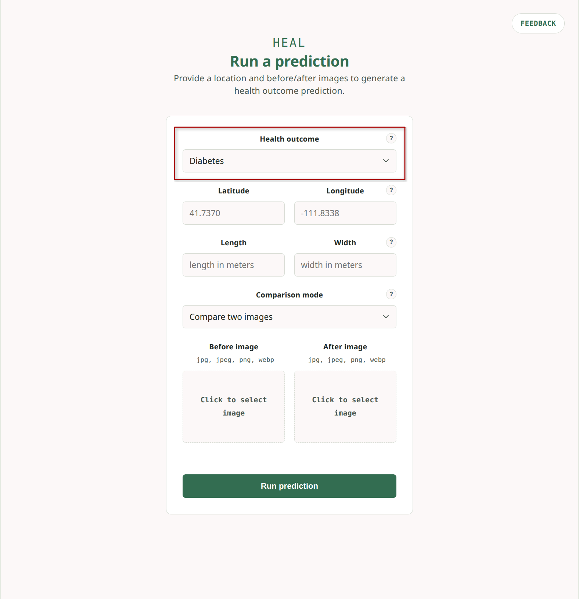
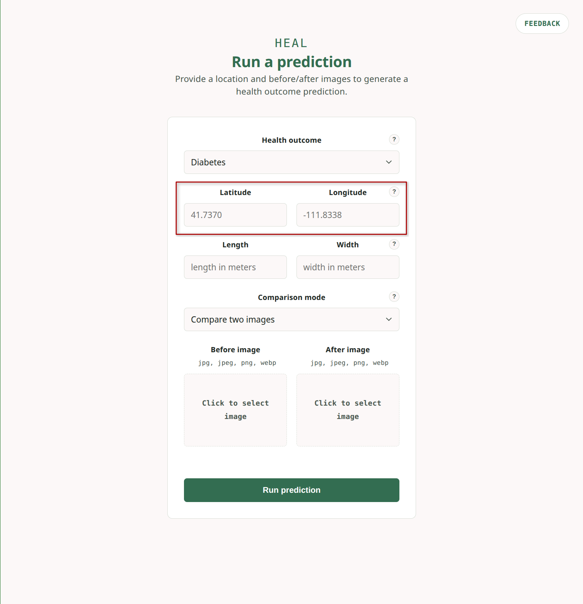
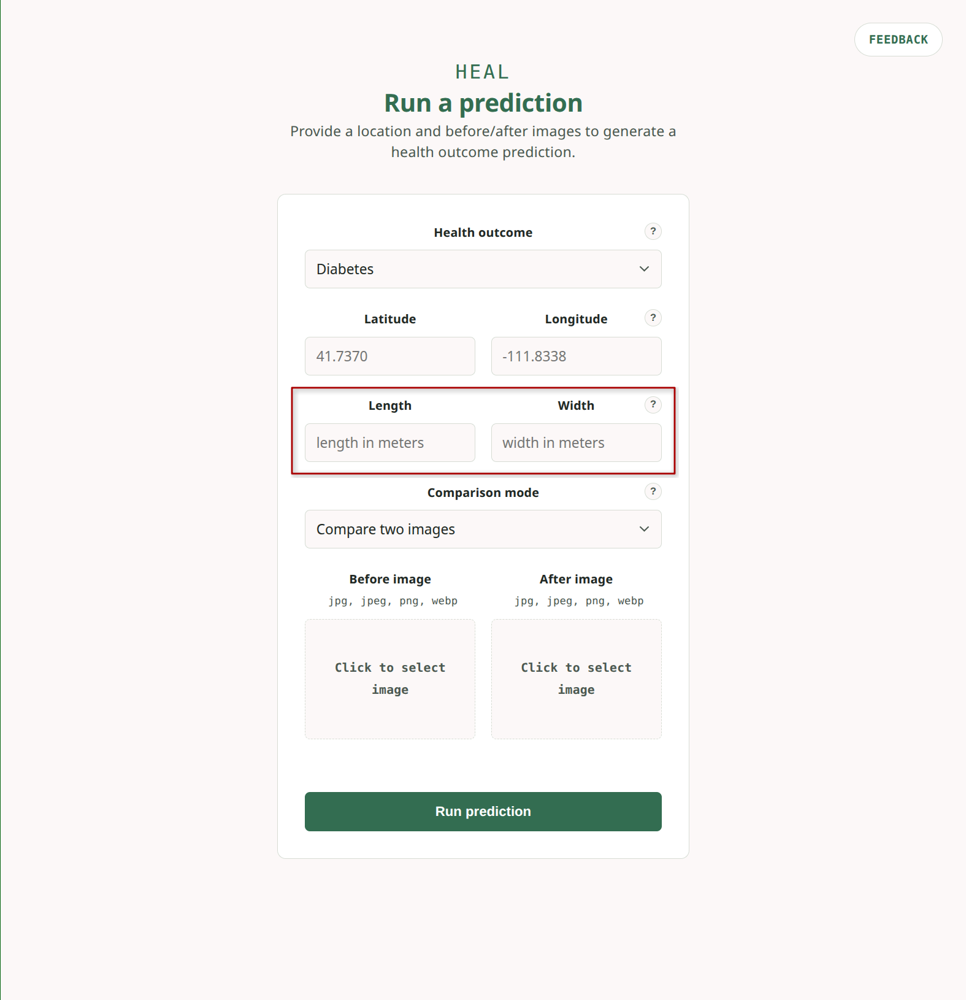
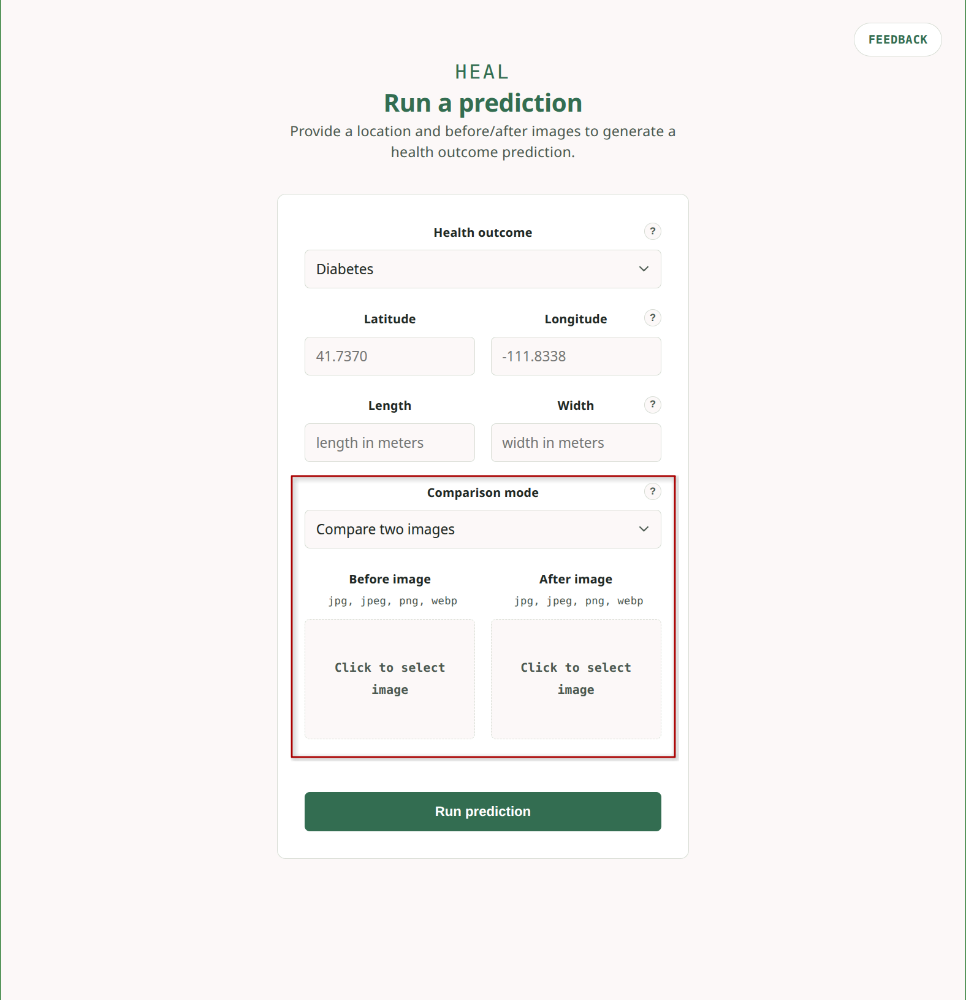
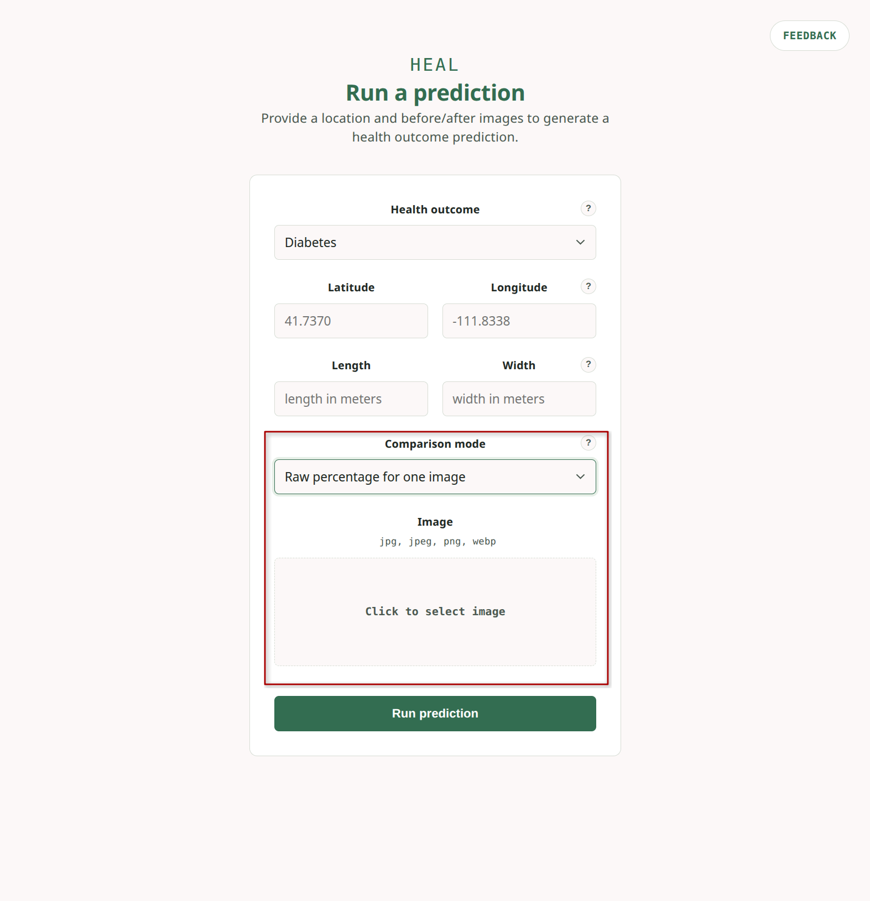
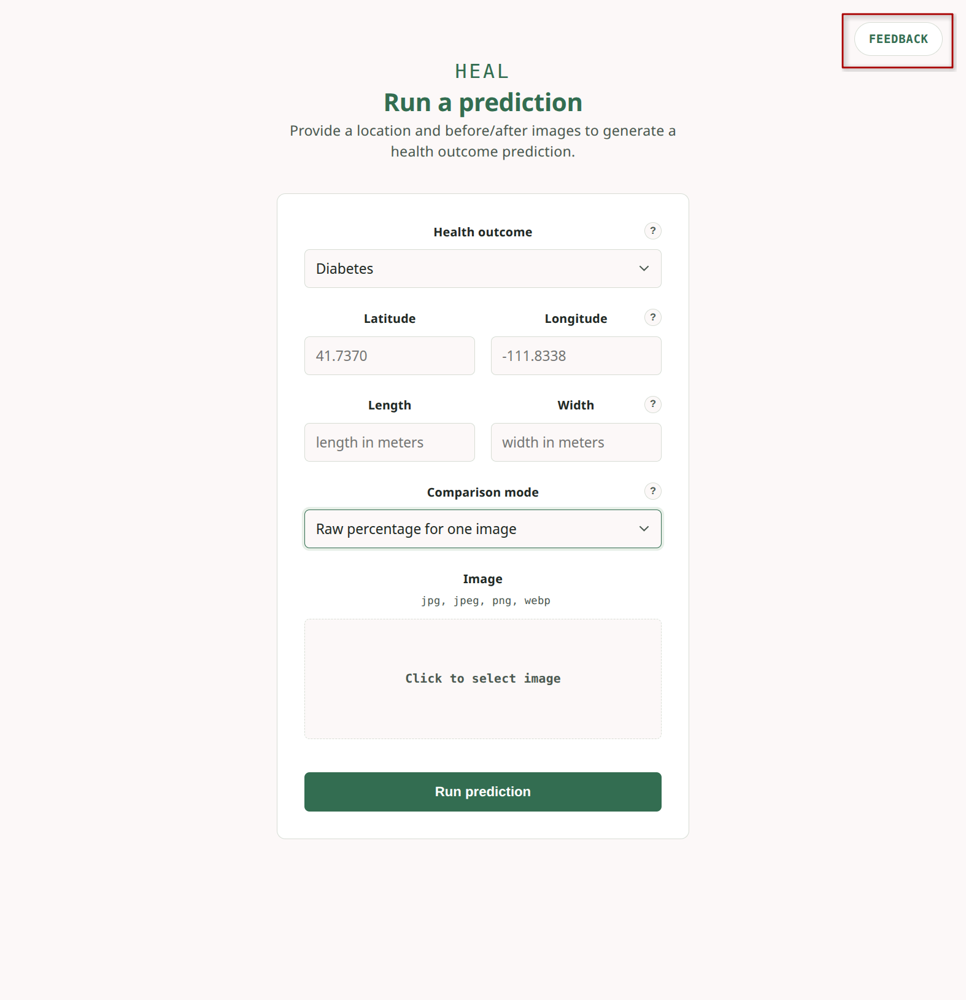
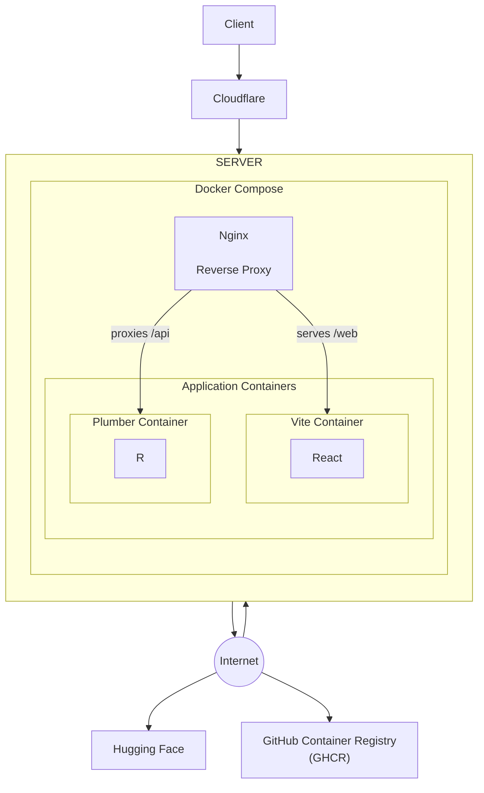

# HEAL Tool

_Transforming urban greenspace data into insights that help predict and improve community health outcomes._

Welcome to the HEAL project! This repository contains the code and resources for analyzing urban greenspace data and its impact on community health. Please refer to the following sections for guidance.

# Table of Contents

- [Getting Started](#getting-started)
- [Contributing](#contributing)
- [Setup](#setup)
- [Local Development](#local-development)
- [Docker Development](#docker-development)
- [Architecture](#architecture)
- [Research](#research)

# Getting Started

To access the HEAL Tool, visit the [HEAL Tool website](https://healstrata.com) and refer to the subsections below.

## Health Outcome

To start, enter a health outcome option from the dropdown menu. The available options include:

- Diabetes
- Chronic Obstructive Pulmonary Disease (COPD)
- Physical Inactivity
- Stroke
- Poor Mental Health
- Coronary Heart Disease (CHD)

This outcome will be the health metric that the tool will analyze in relation to urban greenspace data.



## Latitude and Longitude

Enter the latitude and longitude coordinates for the area you want to analyze. The tool will use these coordinates to map urban greenspace data to the specified location.



## Length and Width

Enter the length and width in meters of the area you want to analyze. The tool will use these dimensions to define the boundaries of the analysis area.



## Comparison Mode

Select between two comparison modes:

### Compare Two Images

Upload two top-down images of urban greenspace areas to compare their impact on the selected health outcome. The tool will analyze the greenspace differences between the two images and output either a positive or negative impact on average health outcome prevalence within a census tract.



### Raw Percentage for One Image

Upload a single top-down image of an urban greenspace area to analyze its impact on the selected health outcome. The tool will calculate the raw average prevalence for the health outcome within a census tract.



## Results

The tool will output a prevalence percentage as well as a summary statement. For example,

## Feedback

We welcome any and all kinds of feedback! Please reach out to us using the **feedback** button or by directly visiting this [form](https://docs.google.com/forms/d/e/1FAIpQLSciTQPKkc485AlSWaZe0KEaLyjRSa4VX3PxEcYzYeoxAYZdrg/viewform).



# Contributing

This project is ongoing! To contribute, please follow the steps below:

1. Create an issue to discuss your proposed changes or additions.
2. Create a feature branch off of `dev` for your changes.
3. Follow the **Local Development Setup** instructions.
4. Thoroughly test your changes to ensure they meet the project's coding standards.
5. Submit a pull request into `dev` for review.
6. Once merged and tested, delete your feature branch and schedule a merge from `dev` into `main` for deployment.

# Setup

1. Clone the repository to your local machine.

   ```bash
   git clone git@github.com:greenscape-tech/greenscape-legacy.git
   cd greenscape-legacy
   ```

2. Create a `.Renviron` file from the `.Renviron.example` in the `api` directory.

   ```bash
   cp api/.Renviron.example api/.Renviron
   ```

3. After gaining access to **Hugging Face**, generate your own token and add it to the `.Renviron` file. You can generate a token by visiting [Hugging Face](https://huggingface.co/settings/tokens). Fill in the rest of the data as needed.

# Local Development

1. Create a `.env` file from the `.env.example` in the `web` directory and fill in the necessary data.

   ```bash
   cp web/.env.example web/.env
   ```

2. Install **R** and **RStudio** if you haven't already. You can follow the official installation guides for [R](https://cran.r-project.org/) and [RStudio](https://www.rstudio.com/products/rstudio/download/).

3. Install the following system dependencies:
   - **Ubuntu/Debian**:

     ```bash
     sudo apt update && sudo apt install -y \
     libsodium-dev \
     libcurl4-openssl-dev \
     libgdal-dev \
     libproj-dev \
     libgeos-dev \
     libudunits2-dev \
     zlib1g-dev \
     tcl-dev \
     tk-dev \
     libmagick++-dev
     ```

   - **Windows**:

     In R, reference the CRAN repo to allow installation of required **R** packages:

     ```terminal
     options(repos = c(CRAN = "https://cloud.r-project.org"))
     ```

4. Install the required **R** packages.

   ```R
   install.packages(c("readxl", "randomForest", "fields", "MLmetrics", "geoR", "raster", "magick", "landscapemetrics", "sp", "spatstat", "curl", "plumber"))
   ```

   > **WARNING**: Installing these packages may take a while. Please be patient and ensure you have a stable internet connection.

5. Install **Node.js** and **npm** if you haven't already. You can follow the official installation guide for [Node.js](https://nodejs.org/en/download/).

6. Install the required **Node.js** packages in the `web` directory.

   ```bash
   npm install
   ```

7. Start the **Node.js** web server (again in the `web` directory).

   ```bash
   npm run dev
   ```

8. Start the **R** API server in a separate terminal.

   ```bash
   Rscript api/start_api.R
   ```

# Docker Development

1.  Install **Docker** and **Docker Compose** if you haven't already. You can follow the official installation guides for [Docker](https://docs.docker.com/get-docker/) and [Docker Compose](https://docs.docker.com/compose/install/).

2.  Build the Docker images.

    ```bash
    docker compose build
    ```

    > **WARNING**: Building this image may take a while. Please be patient and ensure you have a stable internet connection.

3.  Start the Docker containers.

    ```bash
    docker compose up
    ```

# Desktop App

The desktop app runs the same API and UI offline inside a native window (PyWebView). The installer bundles the models, so no network is needed at runtime. Requires Python 3.13+, [uv](https://docs.astral.sh/uv/) and Node.

```bash
cd web && npm ci && npm run build:desktop            # UI -> web/dist
cd ../api
uv sync --group desktop --no-group training
HF_TOKEN=... uv run python desktop/fetch_models.py   # models -> api/models
uv run python desktop/app.py                         # run from source
uv run pyinstaller desktop/heal_tool.spec            # package (build on each target OS)
```

Logs are written to the per-user log directory (`%LOCALAPPDATA%\HEALTool\Logs` on Windows, `~/Library/Logs/HEALTool` on macOS) when running without a console.

# File Structure

```
greenscape-legacy/
├── .github/
│   └── GitHub Actions Workflows
├── api/
│   ├── models/
|   |   └── Trained ML Models
│   ├── scripts/
|   |   └── Training and Download Scripts
│   └── src/
|       └── Plumber API and Prediction Scripts
├── assets/
|   └── Images for README and Testing
└── web/
    └── src/
        └── React Frontend Code
```

# Server Architecture



# Research

## Health Effect Assessment of Landscape (HEAL)

The HEAL Legacy Tool is based on the **Health Effect Assessment of Landscape (HEAL)** technology, developed by Utah State University's Department of Landscape Architecture and Environmental Planning in cooperation with Texas A&M University College of Architecture.

HEAL is a unique technology that creates predictions of possible health outcomes related to urban greenspace design. Using high-resolution satellite imagery and remote sensing technologies, the model estimates the prevalence of:

- Poor Mental Health
- Coronary Heart Disease (CHD)
- Stroke
- Diabetes
- Chronic Obstructive Pulmonary Disease (COPD)
- Physical Inactivity

By analyzing greenspace characteristics such as verdancy, fragmentation, connectedness, aggregation, and shape, combined with social demographic and geographical factors, HEAL provides urban planners and policymakers with evidence-based insights to design healthier communities.

For more information about the research and technology transfer opportunities, visit:
[https://research.usu.edu/rii/tech-transfer/licensing-opportunities/technologies/health-effect-assessment-of-landscape](https://research.usu.edu/rii/tech-transfer/licensing-opportunities/technologies/health-effect-assessment-of-landscape)

**Related Publication:** [https://www.sciencedirect.com/science/article/pii/S0169204623003092](https://www.sciencedirect.com/science/article/pii/S0169204623003092)
